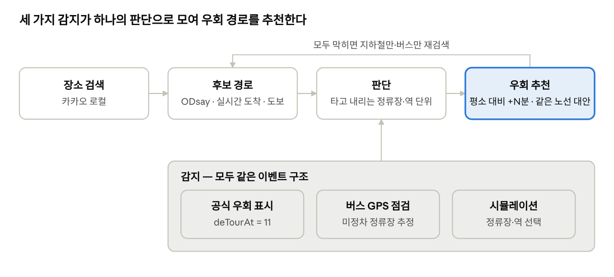

# 실시간 우회 길찾기 — 발표 정리

2026-10-17 (2026-10-18 수정: 지하철 무정차 자동 감지 반영)

## 동기와 문제 정의

자동차 내비게이션의 "실시간 통제 시 우회 안내"를 대중교통에 적용해, 버스가 우회하거나 지하철이 무정차할 때 실시간으로 다른 경로를 제시하는 서울 대중교통 길찾기 웹앱을 만들었다. 1인 학교 프로젝트이며, 사용한 API와 도구는 모두 무료다.

- **문제 상황:** 서울에서는 집회, 행사, 공사로 버스 우회와 지하철 무정차(예: 광화문역)가 자주 일어나지만, 기존 길찾기 앱은 평소 경로만 안내한다.
- **데이터의 공백:** 서울시 버스 API는 노선이 우회 중인지(`deTourAt`)는 알려주지만, **어느 정류장에 서지 않는지는 제공하지 않는다.** 이 정보는 TOPIS 공지 글로만 나온다. 지하철 실시간 API에는 무정차 정보 자체가 없다.
- **핵심 질문:** 운행 중인 버스 자체를 센서로 써서, 공식 데이터에 없는 미정차 정류장을 추정하고 우회 경로까지 연결할 수 있는가?

## 시스템 구조

공식 우회 표시, 버스 GPS 점검, 시뮬레이션이 모두 같은 이벤트 구조로 판단 단계에 들어가고, 판단 결과에 따라 우회 경로를 추천한다.

시뮬레이션과 실제 감지가 같은 구조라서, 시연 때 실제 우회가 없어도 화면과 동작이 같다.

**사용 API와 기술** (모두 무료)

| 구분 | API·도구 | 용도 |
| --- | --- | --- |
| 장소 검색 | 카카오 로컬 API | 건물명·주소 → 좌표 |
| 길찾기 | ODsay LAB (searchPubTransPathT, busLaneDetail, loadLane) | 후보 경로, 노선 정류장 순서와 도로 모양 |
| 버스 도착 | 서울시 정류소정보조회 (getStationByUid) | 실시간 도착, 공식 우회 여부 `deTourAt` |
| 버스 위치 | 서울시 버스위치정보조회 (getBusPosByRtid) | 버스 GPS, 마지막으로 지난 정류장 |
| 지하철 도착 | 서울시 지하철 실시간 도착정보 | 열차 도착 예정 시간 |
| 도보 | OpenRouteService (HeiGIT) | 실제 걷는 길, 회전 안내 |
| 백업 길찾기 | 서울시 대중교통환승경로 조회 | ODsay 대체용 (현재 미사용) |
| 화면 | Python, Streamlit, folium | 웹 화면과 지도 |

## 주요 기능

처음 설계한 기능이 모두 구현되었다. 지하철 무정차 자동 감지는 구현했지만, 실제 무정차 사례가 드물어 실데이터로는 검증하지 못했다. 시뮬레이션과 저장된 경로 데이터로만 확인했다.

| 기능 | 내용 | 상태 |
| --- | --- | --- |
| 장소 검색 | 건물명·주소를 입력하면 후보 목록(이름 + 주소)에서 선택 | 완료 |
| 대중교통 길찾기 | 후보 경로 목록, 구간별 안내(출구 번호 포함), 예상 요금, 지도 표시 | 완료 |
| 실시간 재정렬 | 첫 승차 지점의 실시간 도착 정보로 예상 시간을 다시 계산해 순위 조정 | 완료 |
| 버스 우회 실시간 감지 | 공식 우회 표시(`deTourAt`) + 버스 GPS로 미정차 정류장 추정 | 완료 |
| 우회 경로 제시 | 영향받는 경로를 제외하고 "평소 대비 +N분"으로 추천, 모두 막히면 재검색 | 완료 |
| 같은 노선 유지 대안 | 미정차 지점 대신 다음(이전) 정류장·역에서 타거나 내리는 경로를 나란히 비교 | 완료 |
| 시뮬레이션 | 버스는 노선 + 미정차 정류장, 지하철은 역 + 호선 단위로 선택 | 완료 |
| 도보 길 안내 | 실제 걷는 길을 지도에 표시하고 한국어 단계별 안내, 지하철은 실제 출구에서 출발 | 완료 |
| 지하철 무정차 자동 감지 | 실시간 열차 위치정보의 역 순서로 추정, 2대 이상 확인 | 구현 완료 (실데이터 검증 전) |
| 핸드폰 접속 | Cloudflare Quick Tunnel로 노트북의 앱을 핸드폰 브라우저에서 접속 (무료, 계정 불필요) | 도구 설치 완료, 시연 때 실행 |
| 지하철 막차·첫차 반영 | 서울교통공사 호선별 첫차·막차 정보로 승차역이 운행 종료면 그 경로를 추천에서 제외 (1~9호선) | 구현 완료 (2026-10-19) |

## 핵심 방법

핵심은 노선 전체가 아니라 **정류장 단위로 판단**하고, 공식 데이터에 없는 미정차 정류장을 **버스 GPS로 추정**하는 것이다.

### 1. 실시간 재정렬

- 예상 시간 = max(승차 지점까지 도보, 실시간 대기) + 나머지 소요 시간.
- 출발지에서 걷는 동안 떠나는 차는 탈 수 없으므로 건너뛰고 다음 차를 기준으로 한다.
- 실시간 정보가 없는 경로(예: 마을버스)는 배차 간격의 절반을 평균 대기로 더한다. 이 처리가 없으면 대기 0분으로 계산돼 1위가 되는 문제가 있었다.

### 2. 정류장·역 단위 판단

- 서지 않는 곳이 **타거나 내리거나 갈아타는 지점**일 때만 영향을 받는다고 본다. 중간에 지나가기만 하면 그대로 탄다.
- 지하철은 같은 역이라도 호선별로 판단한다(예: 여의도 5호선 / 9호선).
- 미정차 정류장을 모르는 공식 우회(`deTourAt=11`)는 노선 전체를 피한다.

### 3. 같은 노선 유지 대안

- 승차 지점이 막히면 다음 정류장(역)까지 걸어가서 타고, 하차 지점이 막히면 이전 정류장에서 내린다.
- 추천 경로와 나란히 보여줘서 "원래 버스를 그대로 탈지, 다른 경로로 갈지" 비교할 수 있다.

### 4. 미정차 정류장 추정 (경로 중심 실시간 점검)

1. 길찾기 결과의 버스 노선마다 ODsay에서 정류장 순서와 **실제 도로 모양**(예: 163번 정류장 112개, 좌표 1,059개)을 받는다.
2. 서울시 버스위치 API로 그 노선에서 운행 중인 모든 버스의 GPS와 마지막으로 지난 정류장을 받는다.
3. GPS를 노선에 투영해 기준 이상 떨어지면 '이탈'로 본다. 공식 우회 표시가 있는 노선은 150m, 없는 노선은 300m를 기준으로 한다.
4. 이탈 직전 정류장 다음부터 복귀 후 처음 지난 정류장 전까지를 건너뛴 구간으로 본다. 아직 이탈 중이면 현재 위치까지 지나친 정류장을 본다.
5. 1대가 건너뛰면 '미정차 의심', 2대 이상이면 '미정차 확인'으로 판정한다.
6. 결과를 2번 판단 로직에 그대로 넣는다. 시뮬레이션과 실제 감지가 같은 이벤트 구조를 쓴다.

### 5. 지하철 무정차 추정 (열차 위치 관측)

- 지하철은 버스처럼 GPS와 노선 모양이 없어서, **열차가 찍히는 역의 순서**로 판단한다. "여러 대를 관측해 2대 이상이면 확인"이라는 원칙은 버스와 같지만, 신호가 다르다.
- 실시간 열차 위치(`realtimePosition`)를 받아, 같은 열차의 두 관측이 역 A → 역 C이고 그 사이 역 B에서 도착·출발 기록이 없으면 B를 통과로 본다.
- 관측 간격이 4분을 넘으면 중간에 정차했을 수 있어 판단하지 않는다. 급행 열차는 원래 일부 역을 건너뛰므로 제외한다.
- 역 목록은 길찾기 결과에 이미 받아둔 것을 쓰므로 ODsay를 추가로 부르지 않는다. 역 ID는 ODsay의 stationID와 서울시 역 코드 뒷자리가 같다(9호선 선유도 912로 확인).
- 1대가 통과하면 '의심', 2대 이상이면 '확인'이다. 확인된 역만 경로 판단에 넣는다.

### 6. 도보 계산

- OpenRouteService로 실제 걷는 길을 받고, 회전 종류 코드와 도로 이름으로 한국어 안내를 직접 만든다. 한국어 안내 옵션은 지원되지 않는다.
- 도보 시간은 거리를 분당 66m로 나눈 값이다. ODsay 도보 구간 실측 평균(분당 60~70m, 신호 대기 포함)을 쓴다.
- 예: 세검정 정류장 → 상명대 서울캠퍼스는 ODsay 기준 183m(3분), 실제 길 기준 540m(9분)다.

## 검증 결과

미정차 추정은 가짜 GPS 궤적 테스트에서 정밀도·재현율 1.00을 기록했고, 실제 정상 운행 버스 33대를 잘못 감지한 경우는 0건이다. 약점은 "잘못 감지 줄이기 vs 놓치지 않기"의 균형에서 나온다.

**실제 데이터 보정:** 심야버스 3개 노선(N16, N26, N62)의 33대를 확인했다. 정상 운행 버스는 노선에서 최대 24m 안에 있었고, 이탈 기준(150m)은 그 6배 이상이다.

**가짜 GPS 궤적 테스트** (`test_monitor.py`, 조건마다 20회 반복, 정류장 15개·400m 간격 노선)

| 조건 | 정밀도 / 재현율 (확인 기준) | 비고 |
| --- | --- | --- |
| 정류장 1곳 / 3곳 / 5곳 연속 미정차 | 1.00 / 1.00 | |
| 우회 없음 (정상 운행) | 잘못 감지 0건 | |
| GPS 오차 큼 (30m) | 1.00 / 1.00 | |
| 우회 도로가 가까움 (200m) | 1.00 / 1.00 | 공식 우회 표시가 있을 때 |
| 우회 도로 200m + 공식 표시 없음 | 놓침 | 엄격 기준 300m 때문 |
| 배차 드묾 (버스 4대) | '의심' 단계까지만 | 2대 교차 확인이 어려움 |

**관측 시간에 따른 변화** (정답: 3곳 미정차): 검색 직후 1분이면 전체 구간이 '의심'으로 잡히고, 3분에 2곳, 5분에 3곳 모두 '확인'된다.

**지하철 가짜 운행 테스트** (`test_subway_monitor.py`, 조건마다 20회 반복, 역 12개, 열차 간격 3분, 60초마다 위치 관측. 실제 API 동작이 아니라 제가 세운 가정 위의 결과다)

| 조건 | 정밀도 / 재현율 (확인 기준) | 비고 |
| --- | --- | --- |
| 역 1곳 무정차 | 1.00 / 1.00 | |
| 역 2곳 연속 무정차 | 1.00 / 1.00 | |
| 우회 없음 (정상 운행) | 잘못 감지 0건 | 폴링을 2분으로 늘려도 0건 |

**관측 시간에 따른 변화** (정답: 역 1곳): 3·6·10분 관측으로는 '확인'이 나오지 않고, 20분 뒤에 확인된다. 열차 두 대가 같은 역을 지나가야 해서 배차 간격만큼 기다려야 한다.

**전체 흐름 테스트:** 실제 163번 노선에 이탈 버스 2대를 넣었더니 "국회의사당역.KB국민은행 미정차 확인 → 승차 불가 → 다음 정류소 국회의사당에서 승차"로 이어졌다.

**우회 시나리오 테스트** (선유도역 → 상명대, 평소 경로 9호선 → 5호선 → 7016, 49분)

| 상황 | 추천 | 같은 노선 유지 시 |
| --- | --- | --- |
| 7016번 중간 정류장(효자동) 미정차 | 영향 없음, 평소 경로 그대로 | — |
| 7016번 승차 정류장 미정차 | 9호선 → 163, +4분 | 경복궁역3번출구에서 승차, +13분 |
| 9호선 여의도역(환승역) 무정차 | 9호선 → 163, +4분 | 국회의사당역에서 하차, +16분 |
| 9호선 선유도역(출발역) 무정차 | 양천01 → 2호선 → 7016, +5분 | — |
| 7016번 우회 (정류장 미확인) | 9호선 → 163, +4분 | 노선 전체 회피 |

시간은 2026년 10월 17일 테스트 당시 실시간 값이라 실행할 때마다 달라진다. 같은 노선 유지 시간은 도보를 실제 길로 바꾸기 전 값이다.

## 핸드폰 접속 방법 (Cloudflare Quick Tunnel)

노트북에서 앱을 돌리고, Cloudflare가 임시 공개 주소를 만들어 핸드폰 브라우저가 그 주소로 접속하는 방식이다. 무료이고 계정이나 도메인이 필요 없다. 노트북이 켜져 있고 인터넷에 연결되어 있어야 한다.

1. **설치(완료):** `winget install --id Cloudflare.cloudflared` (2026.10.1 설치, 실행 확인)
2. **앱 실행:** `실행.bat`을 실행하고 창을 열어 둔다. 이 PC에서 http://localhost:8501이 열리는지 확인한다.
3. **터널 열기:** 새 터미널에서 `cloudflared tunnel --url http://localhost:8501`을 실행하고, 출력된 `https://○○○.trycloudflare.com` 주소를 복사한다.
4. **핸드폰 접속:** 핸드폰 브라우저에 그 주소를 입력한다. LTE에서도 접속할 수 있다.
5. **노트북 준비:** 충전기를 꽂고 절전 모드를 끈다.
6. **종료:** 두 창에서 Ctrl+C를 누른다. 주소를 아는 사람은 누구나 접속할 수 있으므로 시연이 끝나면 바로 끈다.

**주의:** 주소는 실행할 때마다 바뀐다. 자동 점검 토글은 꺼 둔다(공공데이터 호출 한도). 노트북 IP가 바뀌면(학교↔집) ODsay 등록 IP를 확인한다.

## 시연 시나리오 (홍대입구역 → 국회의사당역, 2026-10-18 검증)

후보 경로 21개가 나오는 복잡한 구간이다(2호선·9호선 환승, 버스 여러 노선). 평소 1순위는 실시간 기준으로 바뀌므로, 시연에서는 **1순위 경로에 걸리는 상황**을 골라야 "평소 경로가 영향을 받는" 화면이 나온다.

1. 평소 길찾기: 출발지 "홍대입구역", 도착지 "국회의사당역" 입력 → 후보 목록, 도보 길 안내 (스크린샷 01)
2. 6713번 **승차 정류장(홍대입구역)** 미정차 선택 → "평소 경로가 영향을 받습니다" → 우회 추천 2호선→9호선(평소보다 +0분), 같은 노선 대안 +9분 (스크린샷 02)
3. 2호선 **홍대입구역 무정차** 추가 → 2호선→9호선도 막혀 5714→9호선 추천(+3분), 같은 노선 대안 +20분 (스크린샷 03)
4. 실시간 점검 패널: 노선별 운행 버스 수와 내 정류장 상태 (스크린샷 04)
5. 핸드폰 접속: Cloudflare 터널 주소로 열기 (스크린샷 05는 같은 화면을 핸드폰 크기로 찍은 것)

**스크린샷 주의:** 찍을 때 ORS 도보 API가 응답하지 않아서 도보 시간은 직선거리 × 1.3으로 계산되었다. 실제 시연에서 ORS가 응답하면 도보 시간과 길 안내가 달라질 수 있다.

## 지하철 막차·첫차 반영 (2026-10-19)

- 데이터: 서울교통공사 "지하철 호선별 첫차와 막차 정보(전철역코드,외부코드)" API (서비스명 `SearchFirstAndLastTrainbyLineServiceNew`, 1~9호선).
- 방법: 탑승역의 막차 시각을 확인해, 지금 시각이 막차 이후이거나 첫차 전이면 그 경로를 추천에서 뺀다. 같은 노선의 다른 역으로 바꿔도 해결되지 않으므로 대안은 만들지 않는다.
- 역 매칭: 시간표의 역 코드(예: 9호선 선유도 4127)는 우리가 쓰는 ODsay 역 ID(912)와 달라서, 호선·방향·역 이름으로 맞춘다. 방향은 ODsay의 wayCode(1 상행·내선, 2 하행·외선)를 쓴다.
- 검증: 홍대입구역 → 국회의사당역 경로에서 저녁 23시에는 2호선·9호선 경로가 추천에 그대로 있고, 새벽 1시 30분에는 2호선·9호선 경로가 빠지고 공항철도·버스 경로가 추천된다.
- 한계: 공휴일을 평일·토·일과 구분하지 않는다. 승차역만 본다(하차역까지 열차가 가는지는 확인하지 않음). 공항철도 등 1~9호선이 아닌 노선은 판단하지 않는다. 버스 운행 시간은 정류소 도착 정보의 첫차·막차로 본다(아래 "버스 운행 시간 반영" 참고).

## 버스 운행 시간 반영 (2026-10-19)

- 데이터: 기존 서울시 정류소정보조회(`getStationByUid`) 응답의 `firstTm`(첫차)·`lastTm`(막차). 이미 호출하고 있어서 추가 호출이 없다.
- 방법: 승차 정류소가 지금 운행 시간 밖이면 그 경로를 추천에서 뺀다. 지하철 막차와 같은 기준이며, 같은 노선의 다른 정류소로 바꾸는 대안은 만들지 않는다.
- 방면: 첫차·막차는 방면별로 다르다. 방면을 구분하지 않고, 하나라도 운행 시간 안이면 '운행'으로 본다(잘못 빼는 것을 줄이는 쪽).
- 저장: 정류소 도착 정보에서 노선이 빠지는 경우가 있어서, 하루 동안 본 첫차·막차를 저장해 두고 빠졌을 때 쓴다. 호출이 실패해도 저장본으로 판단한다.
- 검증(홍대입구역 → 국회의사당역): 낮 12시에는 변화가 없고, 밤 11시 30분에는 6713·603·761 등 막차가 지난 버스가 빠진다. 새벽 2시에는 2호선·9호선 경로도 빠진다. 새벽 5시에는 2호선·9호선이 첫차 전이라 빠진다.
- 한계: 공휴일·요일별 차이를 구분하지 않는다. 방면을 구분하지 않는다. 저장본은 같은 날에만 쓴다. 정류소 응답에 노선이 없고 저장본도 없으면 판단하지 않는다.

## 스크린샷 (PPT용, `screenshots/` 폴더)

| 파일 | 내용 | 사용 슬라이드 |
| --- | --- | --- |
| 01_검색_평소경로.png | 검색 결과, 평소 경로와 지도 | 1, 5 |
| 02_버스_미정차_우회추천.png | 6713번 승차 정류장 미정차 → 평소 경로 영향, 우회 추천과 같은 노선 대안 | 9, 10 |
| 03_지하철_무정차.png | 6713번 미정차 + 2호선 홍대입구역 무정차 → 지하철 우회 추천 | 9, 10 |
| 04_실시간_점검_패널.png | 버스 노선 실시간 점검 패널 | 6 |
| 05_핸드폰_화면.png | 390px 폭(핸드폰)에서 본 화면 | 10 |

## 발표 시간 계획 (10~15분)

| 시간 | 슬라이드 | 분 |
| --- | --- | --- |
| 0:00~2:00 | 1 소개, 2 문제 제기 | 2 |
| 2:00~4:00 | 3 데이터의 공백, 4 시스템 구조 | 2 |
| 4:00~5:00 | 5 주요 기능 | 1 |
| 5:00~8:00 | 6 미정차 추정, 7 검증 1, 8 검증 2 | 3 |
| 8:00~9:00 | 9 우회 시나리오 | 1 |
| 9:00~12:00 | 10 시연 (라이브 또는 스크린샷) | 3 |
| 12:00~13:00 | 11 한계와 향후 계획 | 1 |
| 13:00~13:30 | 12 마무리 | 0.5 |
| 13:30~15:00 | 질문 여유 | 1.5 |

12장 기준 약 13~14분으로 10~15분 안에 들어간다. 다만 시연을 라이브로 하면 ORS·ODsay 응답이 늦어질 수 있으니, 라이브가 막히면 스크린샷으로 바로 넘어갈 수 있게 준비한다.

## 시연 시나리오 (이전 기준: 선유도역 → 상명대)

선유도역 → 상명대학교 서울캠퍼스 한 경로로, "영향 없음 → 정류장 단위 우회 → 상황 중첩 → 실시간 점검" 순서로 보여준다.

1. 평소 길찾기: 건물명 검색 → 후보 경로(실시간 순) → 지도, 도보 길 안내 펼치기.
2. 7016번 **중간 정류장** 미정차 선택 → "평소 경로는 영향 없음". 노선 전체를 피하지 않는다는 점을 보여준다.
3. 7016번 **승차 정류장** 미정차 선택 → 우회 추천(+N분)과 같은 노선 유지 대안(+N분)을 나란히 비교한다.
4. 9호선 선유도역 무정차 추가 → 상황이 겹치면 추천이 어떻게 바뀌는지 보여준다.
5. 실시간 점검 패널: 내 승차·하차 정류장 상태와 지도 위 버스 위치(초록 정상 / 빨강 이탈)를 보여준다.

**시연 준비 체크리스트**

- [ ] 시연 전날 시연 경로를 한 번씩 검색해 캐시 채우기 (ODsay 무료 일일 한도 대비)
- [ ] 시연 장소의 공인 IP를 ODsay에 등록
- [ ] 시나리오별 화면 캡처 (API 장애 대비)
- [ ] 자동 점검은 시연 중에만 켜기 (공공데이터 호출 한도)
- [ ] 낮 시간에 실제 버스로 실시간 점검 동작 확인
- [ ] 핸드폰 접속 테스트: 터널 주소를 LTE 상태의 핸드폰에서 열어 보기
- [ ] 시연 직전 노트북 절전 해제, 충전기 연결

## 한계와 향후 계획

가장 큰 한계는 데이터다. 지하철 무정차와 버스 미정차 정류장은 공식 API에 없어서 추정에 의존한다.

**한계**

- 지하철 무정차는 API에 무정차 항목이 없어서 열차 위치 기록의 순서로 추정한다. 실제 무정차 사례로는 검증하지 못했고, 시뮬레이션과 저장된 경로 데이터로만 확인했다.
- 지하철 추정은 열차가 통과할 때 위치 API가 어떻게 기록하는지에 대한 가정에 기대고 있다. 폴링 사이에 짧게 정차한 열차는 통과로 잘못 볼 수 있어서 2대 이상일 때만 확인한다.
- 지하철 무정차가 드물어서, 확인에 열차 두 대가 필요한 만큼 시간이 걸린다(시뮬레이션 기준 20분).
- 미정차 추정은 실제 우회 상황으로는 아직 검증하지 못했다. 가짜 궤적과 정상 운행 데이터로만 확인했다.
- 경계 정류장(우회 시작·끝)은 조회 간격 사이에 버스가 지나가면 한 정류장 정도 틀릴 수 있다.
- 결과가 나오려면 버스가 우회 구간을 지나가는 몇 분이 필요하다. 배차가 드문 노선은 '의심' 단계에 머문다.
- 공식 우회 표시가 없고 우회 도로가 가까우면(200m) 놓친다.
- 실시간 대기 시간은 첫 승차 지점만 반영한다. 환승 지점은 계획 시간을 쓴다.
- 같은 노선 대안의 탑승 시간은 정류장 수에 비례한 추정치다.
- ODsay와 공공데이터 API의 무료 일일 호출 한도가 있다. 개발 중 ODsay 한도를 넘긴 뒤 파일 캐시를 추가했다.
- 핸드폰 접속(Cloudflare Tunnel) 방식은 노트북이 켜져 있고 인터넷에 연결되어 있어야 동작한다. 절전 모드에서는 끊긴다.
- 무료 임시 터널 주소는 실행할 때마다 바뀐다. 고정 주소에는 도메인이 필요하다.
- 노트북을 꺼 둔 채로 쓰려면 클라우드 배포가 필요하다. 그런데 ODsay 키가 집 공인 IP 하나로 등록되어 있어서, 클라우드 서버의 IP로는 길찾기가 실패할 가능성이 크다. 고정 IP는 대개 유료이고, ODsay의 다른 등록 방식은 확인하지 못했다.
- 클라우드에 올리면 공개 주소가 생기므로 잠금(비밀번호)이 필요하다.
- 도보 API(OpenRouteService)의 주소가 `api.openrouteservice.org`에서 `api.heigit.org`로 바뀌었다(공식 안내, 2026-10-19 코드 반영). 새 주소에서도 정상 키의 길찾기 요청만 응답이 없어서, 키 상태 확인이 필요하다.
- 도보 API가 응답하지 않으면 한 번 실패한 뒤 10분 동안은 호출하지 않고 직선거리 × 1.3으로 계산한다. 이 처리가 없으면 도보 구간마다 15초씩 기다려 길찾기가 수 분 걸린다(2026-10-19 확인, 적용 후 약 9초). 없으면 외부인이 API 한도를 소진할 수 있다.

**향후 계획**

- [ ] 지하철 무정차 자동 감지 실데이터 검증: 실제 무정차 사례가 생기면 열차 위치 기록으로 확인 (구현 완료, 검증 보류)
- [x] 핸드폰 접속: Cloudflare Quick Tunnel 도구 설치 완료 (시연 때 터널 실행과 핸드폰 테스트만 남음)
- [ ] 실제 우회 사례 수집 후 TOPIS 공지와 비교해 정확도 검증
- [ ] 탄소 비교: 우회 선택지별 "시간 +N분, 탄소 ±N g" 표시 (공식 배출계수 사용)
- [ ] 환승 지점까지 실시간 대기 반영

## PPT 슬라이드 구성안

슬라이드 12장(현재 상황 기준으로 수정, 2026-10-18). 발표의 중심은 6~8번(미정차 추정과 검증)이다. 지하철 무정차 자동 감지는 구현했지만 실데이터 검증이 없으므로 "구현과 가정"으로만 다루고, 실제 우회 사례처럼 말하지 않는다.

| # | 제목 | 핵심 내용 | 자료 |
| --- | --- | --- | --- |
| 1 | 실시간 우회 길찾기 | 한 줄 소개: 내비의 실시간 우회를 대중교통에 | 앱 메인 화면 |
| 2 | 문제 제기 | 집회·행사 때 버스 우회, 지하철 무정차. 기존 앱은 평소 경로만 안내 | 실제 뉴스 사례 1건 |
| 3 | 데이터의 공백 | 버스 API는 "우회 중"만 알려주고 "어느 정류장"은 모름, 지하철 API에는 무정차 항목이 없음 → 핵심 질문 | API 응답 항목 비교 |
| 4 | 시스템 구조 | 감지 → 판단 → 재탐색, 사용 API 6종 (지하철은 열차 위치 API 포함) | 구조도 (시스템구조.png) |
| 5 | 주요 기능 | 길찾기, 실시간 재정렬, 정류장 단위 우회, 같은 노선 대안, 도보 안내, 지하철 무정차 자동 감지(구현) | 화면 캡처 |
| 6 | 운행 상황을 센서로: 미정차 추정 | 버스는 GPS 이탈로, 지하철은 열차가 찍히는 역 순서로 추정. 둘 다 1대 의심 / 2대 확인 | 노선과 이탈 버스 그림, 열차 역 순서 예시 |
| 7 | 검증 (1) 실제 데이터 | 정상 버스 33대 최대 24m, 기준 150m | 거리 분포 |
| 8 | 검증 (2) 가짜 궤적·운행 | 버스 가짜 GPS 정밀도·재현율 1.00, 지하철 가짜 운행 1.00 (가정 기반). 약점과 균형 | 검증 결과 표 |
| 9 | 우회 시나리오 | 중간 정류장은 영향 없음, 승차 정류장은 +4분 우회 | 시나리오 표 |
| 10 | 시연 | 시나리오 1~5 라이브(핸드폰 접속은 Cloudflare Tunnel) 또는 캡처 | 앱, 핸드폰 화면 캡처 |
| 11 | 한계와 향후 계획 | 실데이터 검증 부족, 지하철 추정 가정, 노트북을 켜야 하는 접속 방식, 탄소 비교 | — |
| 12 | 마무리 | 핵심 메시지 한 줄 + 질문 | — |
